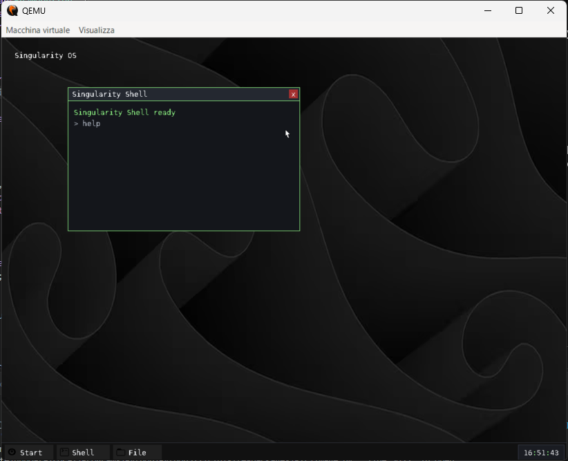

# Singularity OS

Un sistema operativo *freestanding* **x86 (32-bit)** scritto in **C++20** moderno e assembly, avviato tramite **Multiboot** ed eseguito su **QEMU** con terminale VGA, log su porta seriale (`COM1`), gestione della memoria, scheduling dei task, shell interattiva e filesystem `initrd` in formato USTAR.

<div align="center"></div>

## Funzionalità

* **Boot e Architettura di Base**

  * Entry point compatibile Multiboot (`boot.asm`) con passaggio del controllo a `kernel_main`.

  * Global Descriptor Table (**GDT**), Task State Segment (**TSS**), Programmable Interrupt Controller (**PIC**) e Interrupt Descriptor Table (**IDT**).

  * Conteggio dei tick tramite Programmable Interval Timer (**PIT**).

* **Gestione della Memoria**

  * Physical Memory Manager (**PMM**) per il tracciamento dei frame liberi e totali.

  * Allocatore **Heap** del kernel (`Heap::alloc` / `Heap::free`).

  * Configurazione del **Paging** con *identity mapping* e attivazione di `CR3`.

* **Multitasking e Scheduling**

  * Creazione dei task di kernel e *yielding* cooperativo tramite `Scheduler`.

* **I/O, Shell e InitRd**

  * `VgaTerminal` (modalità testo a colori `80x25` con supporto cursore) e debug log su seriale `Serial` (`COM1`).

  * Input da tastiera PS/2 e `Shell` interattiva (`help`, `clear`, `info`, `ticks`, `mem`, `ls`, `cat <file>`).

  * Sottosistema `InitRd` per il parsing di un archivio USTAR `.tar` (`initrd.tar`) caricato tramite Multiboot.

## Struttura del Progetto

```text
Singularity/
├── include/          # Header pubblici (vga.hpp, shell.hpp, initrd.hpp, multiboot.hpp, ...)
├── src/              # Sorgenti di kernel, driver, memoria, scheduler, shell e initrd
├── build/            # File oggetto, binari compilati, directory ISO e initrd.tar
├── Makefile          # Target di compilazione ed esecuzione su QEMU
```

## Compilazione ed Esecuzione

### Prerequisiti

* Toolchain C++20 *freestanding* a 32 bit (`g++` con `-m32 -ffreestanding -std=c++20`) e assembler (`nasm` / `as` in base al `Makefile`).

* Utility per ISO GRUB (`grub-mkrescue` / `xorriso`) per generare `build/os.iso`.

* **QEMU** (`qemu-system-x86_64`) per i test.

## Comandi della Shell

Una volta apparso il prompt `singularity> ` sul display VGA, puoi eseguire:

| Comando | Descrizione |
| ----- | ----- |
| `help` | Elenca i comandi disponibili |
| `clear` | Pulisce il terminale VGA |
| `info` | Mostra informazioni sull'architettura e sul boot |
| `ticks` | Mostra il numero di tick del PIT e il tempo approssimativo |
| `mem` | Mostra l'utilizzo dei frame PMM e dei byte dell'Heap |
| `ls` | Elenca le voci caricate da `initrd.tar` |
| `cat <file>` | Stampa il contenuto di un file presente in `initrd` |
