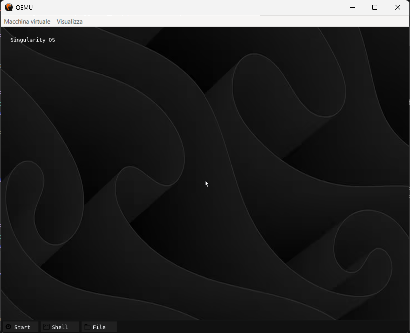
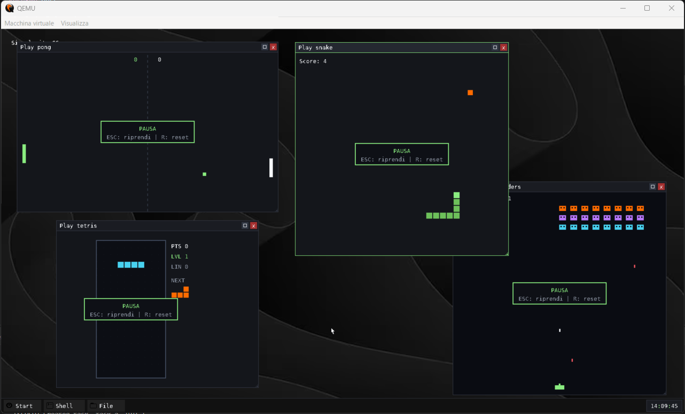

# Singularity OS

Un sistema operativo *freestanding* **x86 (32-bit)** scritto in **C++20** e assembly, avviato tramite **Multiboot** ed eseguito su **QEMU** con terminale VGA, interfaccia grafica con window manager composito, log su porta seriale (`COM1`), gestione della memoria virtuale/fisica, scheduling cooperativo dei task, shell interattiva, applicazioni desktop, giochi arcade e filesystem `initrd` in formato USTAR.

<div align="center"></div>

## Funzionalità

- **Boot e Architettura di Base**
  - Entry point compatibile Multiboot (`boot.asm`) con negoziazione modalità video lineare VBE/framebuffer e passaggio del controllo a `kernel_main`.
  - Global Descriptor Table (**GDT**), Task State Segment (**TSS**), Programmable Interrupt Controller (**PIC**) e Interrupt Descriptor Table (**IDT** + ISR per eccezioni CPU, hardware IRQ e kernel panic).
  - Conteggio dei tick ad alta precisione, delay e scheduling temporale tramite Programmable Interval Timer (**PIT** a 100 Hz) e sincronizzazione oraria hardware con **RTC** (con fuso orario configurabile).

- **Gestione della Memoria**
  - Physical Memory Manager (**PMM**) basato su memory map Multiboot e bitmap di frame fisici da 4 KB.
  - Allocatore **Heap** del kernel (`Heap::alloc` / `Heap::free`, operatori `new` / `delete`) e primitive di memoria ottimizzate (`memcpy`, `memmove`, `memset`, `memcmp`, `strlen`, `strcmp`, `strncmp`).
  - Configurazione del **Paging** x86 (Page Directory / Page Table) con *identity mapping*, mappatura dinamica del framebuffer e del backbuffer, `invlpg` e caricamento di `CR3`.

- **Multitasking e Scheduling**
  - Creazione dinamica dei task del kernel con stack dedicato e *context switching* cooperativo tramite `Scheduler` (`switch.asm`).

- **Motore Grafico, Dirty Rectangles e Ottimizzazioni**
  - **Framebuffer lineare 32-bpp** mappato in memoria virtuale con backbuffer dedicato, primitive veloci in assembly (`rep stosl` / `rep movsl`) per `fill_rect`, `swap_buffers` e `swap_rect`.
  - **Dirty-Rectangle Rendering (`DirtyTracker`)**: tracciamento e fusione intelligente delle aree sporche dello schermo per aggiornare parzialmente solo le porzioni modificate (cursore, orologio RTC, finestre attive), riducendo drasticamente il carico di copia su framebuffer ad alta risoluzione (`1600x900`).
  - **Sfondo da InitRd**: caricamento e decodifica di `wallpaper.bmp` (BMP 24/32-bit non compresso, *top-down* e *bottom-up*) in un buffer statico allineato, con ripristino parziale (`draw_rect_to_backbuffer`) o completo (`draw_to_backbuffer`).
  - **Font bitmap 8x16** e icone vettoriali/pixel-art integrate per il rendering nitido di testo e controlli UI.
  - **FPS Debugger (`FpsDebug`)**: contatore di frame al secondo in tempo reale renderizzato nell'angolo della finestra attiva, attivabile/disattivabile al volo tramite flag.

- **Driver Input, Taskbar e Window Manager**
  - **Driver Mouse PS/2 & Cursore**: inizializzazione della porta ausiliaria PS/2 su IRQ 12, decodifica pacchetti a 3 byte per movimenti e click, rendering del cursore sopra tutti i layer prima dello swap.
  - **Taskbar & Menu Start**: barra inferiore a tutta larghezza con pulsante **Start**, menu popup rapido per lanciare applicazioni, giochi o eseguire **Riavvia** / **Spegni** (ACPI/QEMU), pulsanti rapidi per Shell e File Manager e orologio digitale sincronizzato con l'RTC.
  - **Window Manager Completo**:
    - Gestione multi-finestra con *Z-order* dinamico (*bring-to-front* al click) e indicatore visivo di focus.
    - **Drag & Drop** fluido dalla titlebar.
    - **Resize interattivo** su tutti i lati e gli angoli (sinistra, destra, sopra, sotto e diagonali) con grip visivo nell'angolo in basso a destra e vincoli sulle dimensioni minime e sulla taskbar.
    - Pulsanti di controllo per **Massimizzazione / Ripristino** e **Chiusura** finestra.

<div align="center"></div>

- **Applicazioni Desktop**
  - **Singularity Shell**: terminale grafico con cronologia comandi/risposte colorata, prompt interattivo e cursore lampeggiante.
  - **File Manager (`initrd:/`)**: esplorazione dei file e delle directory caricati nell'archivio `initrd`, selezione riga e apertura diretta nei visualizzatori.
  - **Text Editor / Viewer**: visualizzazione ed editing di file di testo caricati da `initrd`.
  - **Calculator (`CalculatorApp`)**: calcolatrice desktop con supporto alle quattro operazioni base (`+`, `-`, `*`, `/`), reset (`C`), gestione divisione per zero (`ERR DIV 0`), input da mouse e tastiera.
  - **About**: finestra informativa di sistema.

- **Giochi Arcade Integrati**
  - **Pong**: sfida classica con racchette, fisica della pallina e punteggio in finestra.
  - **Snake**: serpente controllabile da tastiera con crescita, cibo e rilevamento collisioni.
  - **Tetris**: tetramini con rotazione, controllo discesa, completamento righe e punteggio.
  - **Space Invaders**: navicella difensiva, ondate di alieni e proiettili in tempo reale.

<div align="center"></div>


- **I/O, Shell e InitRd**
  - `VgaTerminal` (modalità testo a colori `80x25` con cursore hardware) e log diagnostico su porta seriale `Serial` (`COM1`).
  - Driver tastiera PS/2 (IRQ 1, traduzione scancode -> ASCII) collegato a Shell, Editor, Calcolatrice e Giochi.
  - Sottosistema `InitRd` per il parsing completo di archivi USTAR `.tar` (`initrd.tar`) passati come moduli Multiboot.

## Struttura del Progetto

```text
Singularity/
├── boot.asm                  # Entry point Multiboot e setup stack iniziale
├── linker.ld                 # Script di linking per kernel x86 a 1 MB
├── kernel.cpp                # Inizializzazione sottosistemi e main render/event loop
├── include/
│   ├── core/                 # Header kernel, memoria, interrupt, driver PS/2, RTC, framebuffer, BMP, dirty tracker
│   └── graphics/
│       ├── app/              # Header applicazioni desktop (text_editor.hpp, calculator.hpp)
│       └── games/            # Header giochi arcade (pong.hpp, snake.hpp, tetris.hpp, space_invaders.hpp)
├── src/
│   ├── core/                 # Implementazioni GDT, IDT, PIC, PIT, PMM, Heap, Paging, Task, InitRd, Framebuffer, Mouse, Keyboard
│   └── graphics/
│       ├── _window.cpp       # Window Manager (drag, resize multi-bordo, maximize, focus, compositing)
│       ├── taskbar.cpp       # Barra inferiore e gestione stato Start Menu
│       └── app/              # Sorgenti applicazioni (text_editor.cpp, calculator.cpp)
├── initrd_root/              # File impacchettati automaticamente in initrd.tar (es. wallpaper.bmp, file di testo)
├── doc/                      # Roadmap e risorse documentali
├── build/                    # File oggetto, kernel.bin, initrd.tar e immagine avviabile os.iso
└── Makefile                  # Build system e avvio automatico su QEMU
```

## Compilazione ed Esecuzione

Per compilare il kernel, generare `initrd.tar`, creare l'immagine ISO avviabile con GRUB e avviare **QEMU**:

```bash
make clean && make run
```

## Comandi della Shell

Una volta aperto il terminale (o nella **Singularity Shell** grafica), puoi eseguire:

| Comando | Descrizione |
| ----- | ----- |
| `help` | Elenca tutti i comandi disponibili |
| `clear` | Pulisce la cronologia del terminale |
| `info` | Mostra informazioni sull'architettura, CPU e stato del boot |
| `ticks` | Mostra il numero di tick del PIT e l'uptime approssimativo |
| `mem` | Mostra l'utilizzo dei frame fisici del PMM e dei byte allocati nell'Heap |
| `ls` | Elenca i file e le directory caricati da `initrd.tar` |
| `cat <file>` | Stampa il contenuto di un file presente in `initrd` |
