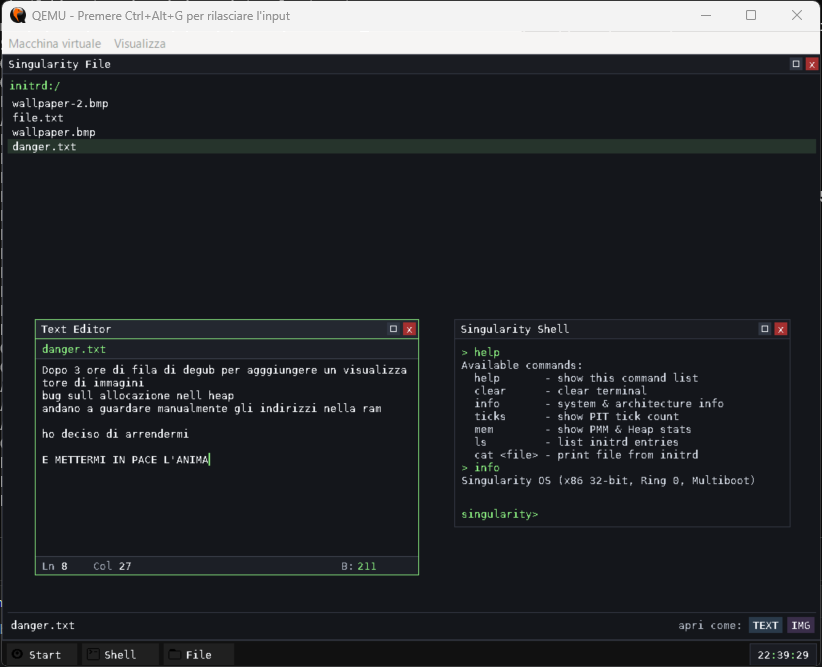

# Singularity OS

Un sistema operativo *freestanding* **x86 (32-bit)** scritto in **C++20** moderno e assembly, avviato tramite **Multiboot** ed eseguito su **QEMU** con terminale VGA, interfaccia grafica con window manager, log su porta seriale (`COM1`), gestione della memoria, scheduling dei task, shell interattiva e filesystem `initrd` in formato USTAR.

<div align="center"></div>

## Funzionalità

- **Boot e Architettura di Base**
  - Entry point compatibile Multiboot (`boot.asm`) con flag video e passaggio del controllo a `kernel_main`.
  - Global Descriptor Table (**GDT**), Task State Segment (**TSS**), Programmable Interrupt Controller (**PIC**) e Interrupt Descriptor Table (**IDT** + ISR per eccezioni CPU e panic).
  - Conteggio dei tick, delay e timer tramite Programmable Interval Timer (**PIT**) e sincronizzazione oraria con **RTC**.

- **Gestione della Memoria**
  - Physical Memory Manager (**PMM**) basato su memory map Multiboot e bitmap di pagine da 4 KB.
  - Allocatore **Heap** del kernel (`Heap::alloc` / `Heap::free`, `new` / `delete`) e funzioni base (`memcpy`, `memmove`, `memset`, `memcmp`, `strlen`, `strcmp`, `strncmp`).
  - Configurazione del **Paging** (Page Directory / Page Table) con *identity mapping*, `invlpg` e caricamento di `CR3`.

- **Multitasking e Scheduling**
  - Creazione dei task di kernel e *yielding* cooperativo tramite `Scheduler`.

- **Grafica, Mouse, Taskbar e Window Manager**
  - **Framebuffer lineare** mappato in memoria virtuale con backbuffer, `put_pixel`, `fill_rect` e `swap_buffers`.
  - **Sfondo da InitRd**: caricamento e decodifica di `wallpaper.bmp` (BMP 24/32-bit non compresso) in un buffer dedicato e disegno su backbuffer ad ogni frame.
  - **Font bitmap 8x16** per il rendering del testo grafico sul framebuffer.
  - **Driver Mouse PS/2 & Cursore**: porta ausiliaria PS/2, IRQ 12 su PIC/IDT, pacchetti a 3 byte per coordinate e click, cursore disegnato sopra tutti i layer prima dello swap.
  - **Taskbar**: barra inferiore a tutta larghezza con pulsante Start e menu popup delle app, elenco finestre aperte, tick/uptime collegato a `Timer::ticks()` e orologio sincronizzato con l'RTC.
  - **Mini Window Manager & App**: gestione finestre (`Window`), drag dalla titlebar, focus al click, massimizzazione e chiusura, affiancate da **Shell grafica**, **File Viewer** per `initrd`, **Editor di Testo** e **Visualizzatore di immagini** (in lavorazione / da completare).

- **I/O, Shell e InitRd**
  - `VgaTerminal` (modalità testo a colori `80x25` con supporto cursore) e log di debug su seriale `Serial` (`COM1`).
  - Input da tastiera PS/2 (scancode -> ASCII) e `Shell` interattiva (`help`, `clear`, `info`, `ticks`, `mem`, `ls`, `cat <file>`).
  - Sottosistema `InitRd` per il parsing di un archivio USTAR `.tar` (`initrd.tar`) caricato tramite Multiboot.

## Struttura del Progetto

```text
Singularity/
├── include/          # Header pubblici (vga.hpp, shell.hpp, initrd.hpp, multiboot.hpp, framebuffer.hpp, ...)
├── src/              # Sorgenti di kernel, driver, memoria, scheduler, shell, GUI e initrd
├── doc/              # Roadmap e risorse documentali
├── build/            # File oggetto, binari compilati, directory ISO e initrd.tar
├── Makefile          # Target di compilazione ed esecuzione su QEMU
```

## Comandi della Shell

Una volta apparso il prompt `singularity> ` sul display VGA (o nella finestra del terminale grafico), puoi eseguire:

| Comando | Descrizione |
| ----- | ----- |
| `help` | Elenca i comandi disponibili |
| `clear` | Pulisce il terminale VGA |
| `info` | Mostra informazioni sull'architettura e sul boot |
| `ticks` | Mostra il numero di tick del PIT e il tempo approssimativo |
| `mem` | Mostra l'utilizzo dei frame PMM e dei byte dell'Heap |
| `ls` | Elenca le voci caricate da `initrd.tar` |
| `cat <file>` | Stampa il contenuto di un file presente in `initrd` |